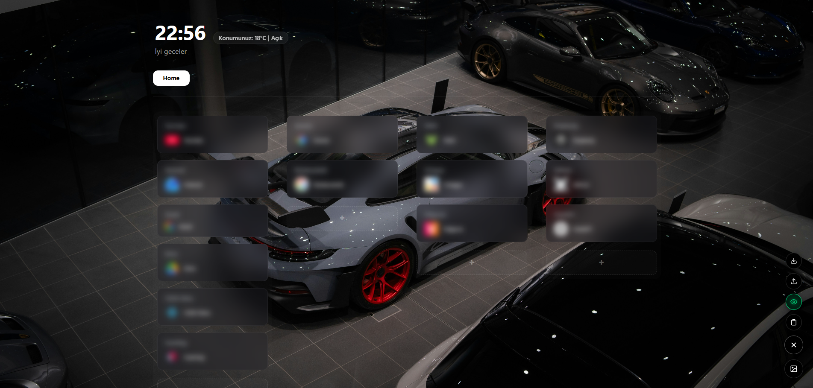

# CustomTab

A minimalist and fully customizable New Tab page extension for Google Chrome. Organize your links in columns, rearrange them via drag-and-drop, and build your own clean workspace.

---

## Features

- **4-Column Link Board:** Categorize and manage your links efficiently.
- **Drag & Drop:** Move link cards freely across or within columns.
- **Custom Background:** Instantly change your wallpaper by uploading any local image.
- **Minimalist Live Clock:** A clean, distraction-free digital clock.
- **Streamer Mode:** Instantly blur link details with a single click for privacy during screen sharing or recording.
- **TXT Backup (Import/Export):** Easily backup and restore all your links and settings via `.txt` files.
- **Quick Copy:** Copy all saved links to your clipboard with one click.

---

---

## Installation

1. Download this repository (`Code > Download ZIP`) and extract it into a folder.
2. Open Google Chrome and navigate to `chrome://extensions/`.
3. Enable **Developer Mode** using the toggle in the top-right corner.
4. Click **Load unpacked** in the top-left corner.
5. Select the extracted extension folder.
6. Open a new tab to start using your custom dashboard.

---

## Tech Stack

- **HTML5 & CSS3:** Flexbox, CSS Grid, and Glassmorphism UI design.
- **Pure JavaScript (Vanilla JS):** DOM manipulation, Drag and Drop API.
- **Chrome Extension API (Manifest V3):** Local data management via `chrome.storage.local` and `chrome_url_overrides`.
